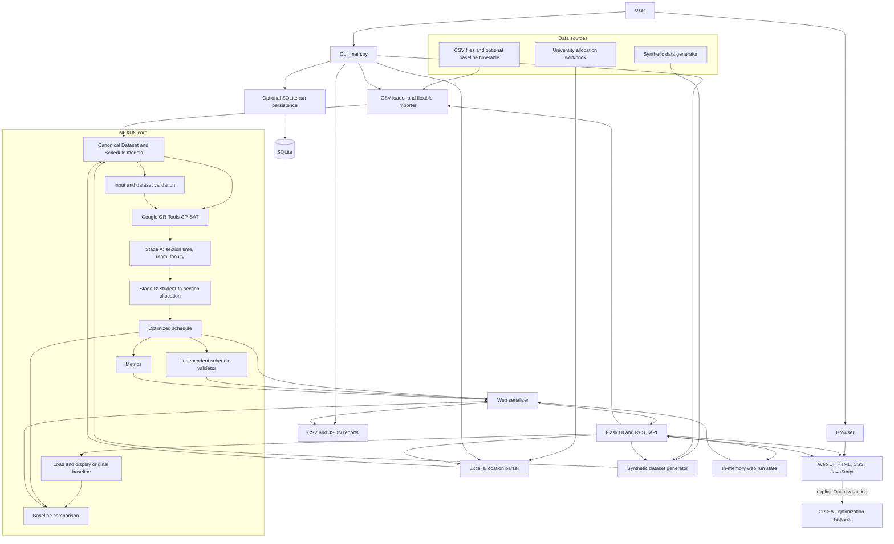
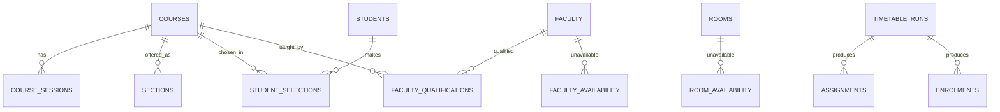

# Architecture

Timetable generation and student allocation use CP-SAT only. Failed CP-SAT runs are not replaced by heuristic schedules.
Real university Excel/CSV import, optional baseline `timetable.csv`, fixed/preferred/flexible assignment modes,
independent H10 validation, and original-versus-optimized comparison are implemented. Flexible column mapping is
available through `nexus_core.importer` and `/api/import/*`. Full Excel export remains limited (CSV/JSON export work).

The web startup path parses the packaged workbook and attaches the original baseline only. `/api/current` and `/api/original` do not invoke CP-SAT. An explicit optimization request runs Stage A and Stage B and stores its result separately from the baseline in web state. The web app currently stores active state in process memory and serializes API access with a process-local lock; it does not yet persist uploads or runs through SQLite, so restarts clear the active imported/optimized state. Multi-worker deployment requires shared persistence/coordination. No alternative timetable construction or fallback is used. For generated datasets over 30 sections, optional pairwise conflict and back-to-back teaching preferences are omitted to control model build time; resource, qualification, workload, session, and allocation constraints remain hard. The workbook's two representative student rows per cohort and estimated room/section capacities are labeled in the UI; they are not authoritative enrolment or inventory data.

