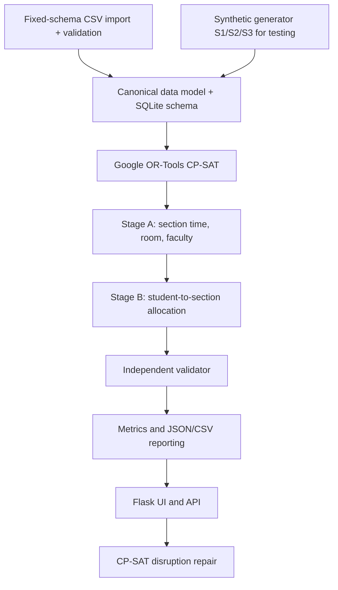
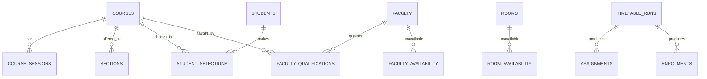

# Architecture

Timetable generation and student allocation use CP-SAT. The standalone heuristic scheduler has been removed; no
optimization route silently substitutes a heuristic schedule when CP-SAT returns `UNKNOWN`. Dataset column mapping,
baseline/fixed timetable assignments, Excel export, and original-versus-optimized comparison are not implemented yet.
